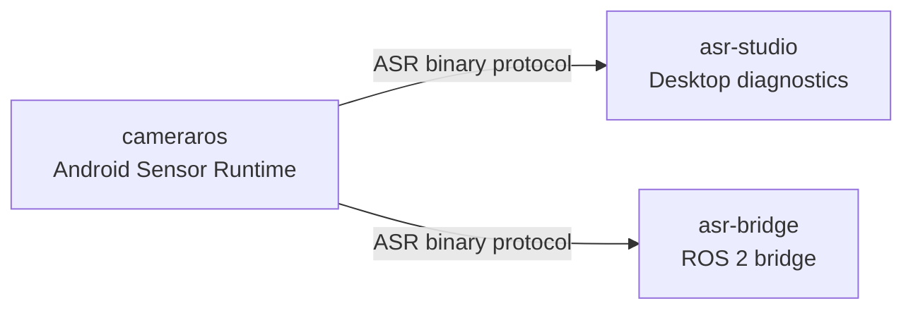
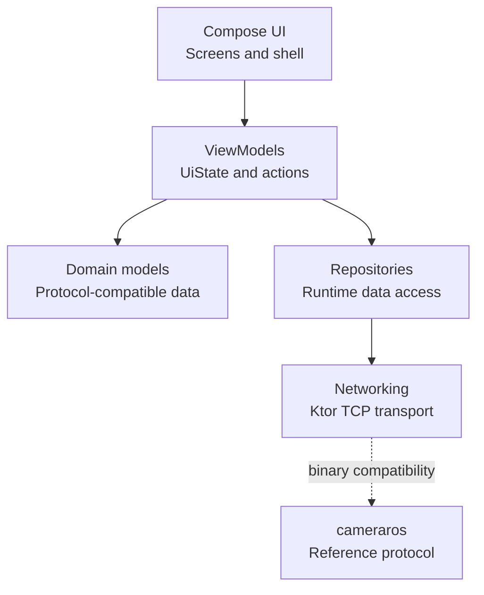

# ASR Studio Architecture

ASR Studio is a Compose Multiplatform Desktop application for diagnostics, visualization, and documentation for the Android Sensor Runtime ecosystem.

## Repository Relationship

- `cameraros` is the Android hardware runtime and protocol authority.
- `asr-studio` is a desktop diagnostics and visualization tool.
- ASR Studio must remain binary compatible with `cameraros`.
- ASR Studio must not require changes to `cameraros`.

## Application Layers

## Phase 1 Scope

Phase 1 contains only the application foundation:

- Compose Desktop entry point
- Material 3 theme
- Static app shell
- Local navigation state
- Placeholder screens

Phase 1 intentionally excludes:

- Networking
- Packet parsing
- Serialization
- Repositories
- Diagnostics logic
- Local persistence
- Android repository changes

## MVVM Direction

The approved architecture is MVVM:

- UI renders immutable screen state.
- ViewModels expose state through `StateFlow`.
- UI sends user actions to ViewModels.
- Repositories own data access.

Phase 1 may use local Compose state for placeholder navigation because no feature state or data layer exists yet.

## Network Architecture

Networking will be implemented in a later phase after inspecting `cameraros`.

Required compatibility areas include:

- Packet layout
- Topic IDs
- Flags
- CRC implementation
- Serialization rules
- Payload parsing
- Command IDs
- Transport behavior

If the Android implementation conflicts with the written specification, stop and ask which source is canonical.

## UI Architecture

The desktop shell is organized as:

- Sidebar for primary navigation
- Title bar for current screen context
- Content area for the active screen
- Status bar for connection/build/runtime state placeholders

Screens remain placeholders until their roadmap phase is approved.
