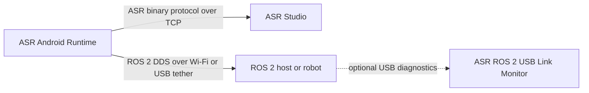
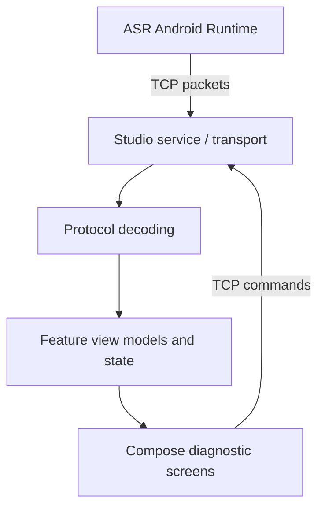

# ASR Studio Architecture

ASR Studio is a Kotlin and Compose Multiplatform desktop application for inspecting telemetry from ASR Android Runtime. It is a TCP diagnostics client; ROS 2 DDS is a separate transport used by the Android runtime and ROS 2 participants.

## System overview

- **ASR Android Runtime** owns the phone sensors, transport controls, and published ROS 2 topics.
- **ASR Studio** connects to the phone over TCP, directly over Wi-Fi or through ADB reverse port forwarding over USB. Its default port is `4242`.
- **ROS 2 DDS** is configured independently. Android uses Cyclone DDS; the documented host setup uses `rmw_fastrtps_cpp` and the same `ROS_DOMAIN_ID`.
- **ASR ROS 2 USB Link Monitor** is an optional host diagnostic for USB-tethered DDS. It is not required for Wi-Fi DDS and is not an ASR Studio dependency.

## Application structure

The Gradle project has two modules:

- `shared/` contains Compose UI, screen state/view models, protocol and data code, and shared resources. The current desktop target is JVM.
- `desktopApp/` contains the desktop entry point, native distribution configuration, and desktop resources such as the phone model.

The main UI is organized under `shared/src/commonMain/kotlin/org/asr/studio/ui/` by feature: camera, dashboard, devices, diagnostics, docs, inspector, speaker, and shared components/theme. `App.kt` owns the desktop navigation shell and the application-level view model instances.

## Data flow

TCP packet transport and ROS 2 DDS are distinct. ASR Studio does not bridge DDS, and ADB reverse is only a transport route for the Studio TCP connection. Consult the companion Android Runtime repository when verifying packet semantics, command behavior, or topic definitions.

## IMU orientation view

The IMU page renders a phone model in a JVM 3D viewport. The model receives the live orientation quaternion from the Android IMU packet and presents world directions, body axes, Euler angles, and camera view presets. View manipulation changes the observer camera; it must not alter sensor-derived device orientation. The viewport implementation is in `shared/src/commonMain/kotlin/org/asr/studio/ui/diagnostics/JmeOrientationViewport.kt`.

## Documentation and release information

- `README.md` is the entry point for building, connecting, and using the app.
- The in-app Documentation screen covers setup, TCP connectivity, sensor topics, protocol details, and USB DDS helper scope.
- `ROADMAP.md` tracks user-facing work and remaining release readiness items.
- The About screen displays the desktop package version. Keep it aligned with `desktopApp/build.gradle.kts`.

No license is currently included in this repository. Do not describe the project as open source until an appropriate license and third-party notices are added.
